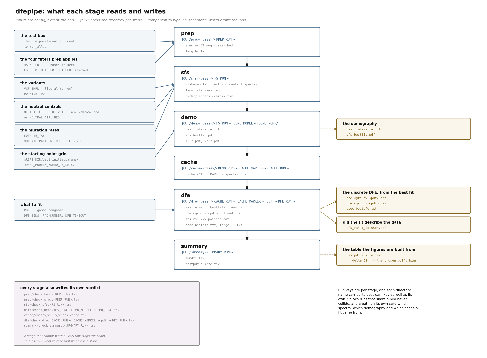

# dfepipe

Infer a **distribution of fitness effects** for a set of noncoding regions given
as a bed file.

Selected sequence carries fewer common variants and more rare ones, because
deleterious mutations are removed before they spread, so the site frequency
spectrum of the target regions encodes selection. Population history distorts
every spectrum in the genome, though, so this pipeline first fits a demographic
model to neutral control regions **near each target interval**, then asks what
distribution of selection coefficients must be added on top of that demography
to explain the target spectrum.

Keeping the controls local is what makes the comparison work: it matches
mutation rate, recombination and coverage between target and control, so the
difference that remains is attributable to selection rather than to where in the
genome the targets sit.



## What you need

- a cluster running UGE/SGE, and conda
- the reference data: 1000 Genomes VCFs and accessibility mask, GENCODE CDS,
  ChromHMM states, Roulette mutation rates, and a neutral control set. These are
  not shipped and cannot be — `config/profiles/template.conf` lists every path a
  site must provide
- `bash setup/setup.sh`, which builds the conda environment and applies the dadi
  and dadi-cli patches that add the `neugamma` density

**This is human GRCh38 data only.** Every reference input — the VCFs, the mask,
the CDS, the ChromHMM states, the mutation rates and their scale constant — is
human and GRCh38. Another species is a porting project, not a configuration
change.

## Running it

```bash
source config/profiles/<yoursite>.conf
export PREP_RUN=prep_261110 FS_RUN=fs_261110 DEMO_RUN=demo_261110 \
       CACHE_RUN=cache_261110 DFE_RUN=dfe_261110 SUMMARY_RUN=sum_261110

DRY_RUN=1 bash scripts/chains/run_all.sh their.bed    # always, first
bash scripts/chains/run_all.sh their.bed
```

Several beds can go in one chain; each gets its own controls, demography, cache
and DFE. The answer is one row per bed in
`$OUT/summary/$SUMMARY_RUN/bestpdf_sumdfe.tsv`.

The chain submits itself forward in three phases, so `qstat` shows only the
current one and the rest arrives later through launcher jobs. Jobs appearing,
vanishing and reappearing an hour later is normal.

## Before you trust a result

- **A DFE is population-specific.** The configured data is 1000 Genomes YRI, 108
  individuals, projected to 160 chromosomes.
- **Confirm the assembly by hand.** The preflight cannot detect a bed from
  another build; it only catches a coordinate running far past the mask.
- **Long regions are not supported.** An interval longer than `2 × CTRL_FLANK`
  (50 kb) encloses its own control window, finds no control, and is dropped
  without appearing in the result. See the warning in `docs/PIPELINE.md`.
- Every stage writes a check file. Read them: a FAIL stops the chain, a WARN is
  a judgement for you.

## Where to go next

| | |
|---|---|
| `AGENTS.md` | the front door, and the full briefing: what to settle before spending cluster time, the configuration in three tiers, how to read each check, what to do when a run stops |
| `docs/PIPELINE.md` | per-stage detail: what each stage reads and writes, what every threshold means and why it is the number it is |
| `examples/encode_els/` | one worked run on ENCODE enhancer-like signatures, with the expected outputs and what it cost |
| `docs/io_schematic.pdf` | the picture above; `docs/pipeline_schematic.pdf` draws the same pipeline as jobs |
| `TODO.md` | known-unfinished work, and the open questions |

Results from this package reproduce the published values it was built against to
well inside the bootstrap spread; `docs/questions.md` records the one deliberate
numerical difference and what else was found while porting.
